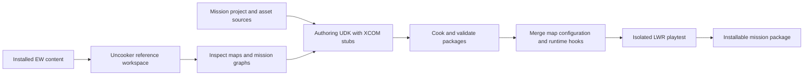

# Mission editor feasibility: verified update

Research date: **3 November 2026**. Target: the installed **Enemy Within + Long War Rebalance** game under `<Steam common>\XCom-Enemy-Unknown\XEW`. The parent directory also contains Enemy Unknown; these results do not establish identical support there. Scope is a single-player editor whose output can participate in the campaign.

The findings and corrections from this investigation have been incorporated into the [main research document](<mission-editor-research.md>). This report retains the detailed evidence and experiment matrix; references to earlier conclusions describe the document before consolidation. Work performed: package/config inspection, read-only executable inspection, public source-code review, and online research. **No game files were changed, UDK was not installed, and no newly authored mission was run.**

## Assessment

**A useful mission editor has a credible foundation. A complete editor supporting arbitrary new maps and arbitrary new art still needs an experimental compatibility phase.** There are three increasingly difficult deliverables:

| Deliverable | Assessment | Basis |
|---|---|---|
| Edit existing maps: add scenery, cover, ladders, spawns and mission variants | Strong basis for implementation | Installed community map layers, matching public sources, existing mutator hooks |
| Create a substantially new layout inside an existing map's playable bounds | Plausible; whole-layout gameplay must be demonstrated | New geometry and local rebuilds are established; full replacement of terrain and stale baked data is a separate test |
| Create independent maps with new bounds, custom art and arbitrary mission rules | Research-dependent | Native world data, shader compatibility, mission lifecycle and campaign registration remain integration problems |

The recommended architecture is **UDK September 2011 as the initial scene editor/compiler, plus an XCOM-specific mission layer**. Use XCOM Uncooker for reference inspection. A friendlier standalone interface can later generate input for this backend; a standalone interface does not require writing an entirely new cooker.

## What the installed files establish

The repeatable [audit](<evidence/installed-game-audit.json>) covers all top-level `.upk`/`.u` headers in EW's `CookedPCConsole`, all `patch_*.upk` export tables, and selected object properties. Counts describe this installation, not every EW/LWR version.

| Observation | Measured result | Implication |
|---|---|---|
| Package files | **2,993**, all with package version **845** | A generic modern Unreal editor is not the relevant toolchain |
| Licensee markers | **110** licensee-0; **2,883** licensee-64 | UDK-format and Firaxis-format packages coexist; the marker alone does not prove authorship |
| Engine builds | 2,937 build 8916; 56 build 8917 | Match the community toolchain, then test actual serialization compatibility |
| Patch maps | **90**, all licensee-0, engine 8916, cooker 135 | There is a concrete existing map-layer format to reproduce |
| Map configuration | **188** active `Maps=` records; **153** marked in rotation | Configuration already separates mission/map selection from geometry |
| Patch references | **323** occurrences referring to **87** distinct patch names; none missing | Count occurrences and distinct names separately |
| Installed but unreferenced patch names | `patch_hideroofs`, `patch_museum_multi`, `patch_streetoverpass` | Presence on disk does not mean enabled in the current map configuration |
| Texture caches | `Textures.tfc`, `Textures_startup.tfc`, `CharTextures.tfc`, `Lighting.tfc` | These are the four top-level caches found; this is not a test of other cache names |

Twelve core/startup packages use an outer LZO-compressed wrapper. Reading that wrapper explains the difference from the earlier count of 2,981 packages. The final audit parsed all 2,993 headers without errors.

Across the 90 patches, export tables contain **845 `XComLevelActor`**, **409 `XComRebuildWorldDataVolume`**, **81 `XComLadder`**, **90 `XComDestructibleActor`**, **163 `StaticMesh`**, **40 `SeqAct_SetLOSBlocking`**, and **43 `SeqAct_SetCover`** entries. These are serialized export counts, which can include defaults and repeated resources across packages; they are not counts of unique assets or necessarily placed actors.

For a small concrete example, `patch_bar.upk` contains meshes named `CoverPatch.High2x2`, `CoverPatch.highcover`, and `LadderMetal.Meshes.LadderMetalA_448`, plus rebuild volumes and a Kismet sequence. Its public source counterpart is available in [LiQuiD911's patch-map project](https://github.com/iiiLiQuiDiii/UDK/tree/80be6f4c21b665e0c261bee224429cb36c3fc217/UDK-2011-09/UDKGame/Content/Maps/patches). Matching names do not establish that every installed patch is byte-for-byte derived from that revision.

There are **no `Texture2D` or base `Material` exports** in these 90 patches, although there are 13 material-instance exports. Thus these files provide stronger evidence for geometry and gameplay extensions than for an unrestricted new texture/shader pipeline. Separately, `LWRPictures.upk` contains 23 texture exports; UI textures are not proof of streamed world-texture compatibility.

## Important additions to the earlier research

### Existing maps can be reconstructed for inspection

[XCOM Uncooker](https://github.com/chrishayesmu/XCOM-Uncooker) reconstructs EW packages for browsing maps, meshes, textures and Kismet in September 2011 UDK. Its latest published release found was [v1.1.0](https://github.com/chrishayesmu/XCOM-Uncooker/releases/tag/v1.1.0), released 26 July 2024. Material reconstruction is approximate, and some materials need supplied manual replacements.

This changes the proposed first step: evaluate this existing viewer before writing a map-reference exporter. Keep its UDK installation separate from the script-building/cooking installation, as its setup replaces UDK components. The project's documentation explicitly does **not** promise playable map or asset round trips.

The distinction is visible in the source: [`XComWorldData.cs`](https://github.com/chrishayesmu/XCOM-Uncooker/blob/c12648d52651946f35598e659cfa8db10d9a44d3/UnrealPackageLibrary/Unreal/ObjectSubtypes/XCom/XComWorldData.cs) reads the native world-data pointer but does not write or remap it into the reconstructed package. Simply saving the reconstructed map cannot preserve that complete native dataset.

There are also practical automation limits: [`Program.cs`](https://github.com/chrishayesmu/XCOM-Uncooker/blob/c12648d52651946f35598e659cfa8db10d9a44d3/XCOM-Uncooker/Program.cs) accepts input/output directories, skips `patch_` files, and enumerates four named texture caches. Therefore it is a promising reference backend, not an already complete importer for all mod content.

### Custom materials have a documented route

Long War Community Edition documents two executable changes which enable runtime compilation of custom materials. This is an explicit implementation, beyond the older reports of default-material fallback. See [LWCE executable patch notes, patches 3 and 4](https://github.com/chrishayesmu/XCOM-LW-CommunityEdition/blob/71d2164ca8d76883ff5afa24ee5062596c880088/Notes/exe_patches.md).

A **read-only** scan of this installation found each original byte signature exactly once and each replacement signature zero times:

| Documented shader patch | Original signature occurrences | Patched signature occurrences |
|---|---:|---:|
| Patch 3 | 1 | 0 |
| Patch 4 | 1 | 0 |

The executable's SHA-256 is recorded in the [pattern audit](<evidence/executable-pattern-audit.json>). This establishes that those particular changes are absent, not that every possible shader-related modification is absent. Signature matches make a controlled experiment practical; they do not establish compatibility or authorize treating the patches as tested here.

**Recommendation:** evaluate just the material-enabling mechanism against an isolated LWR test installation. Installing the whole of LWCE is a different undertaking: its [README](https://github.com/chrishayesmu/XCOM-LW-CommunityEdition) describes extensive class replacement and warns about compatibility with other major mods. Runtime shader compilation can introduce first-use hitches; texture serialization and persistence of generated shaders still need separate tests.

### There is newer custom-map experimentation

In a first-person [modding report](https://www.reddit.com/r/Xcom/comments/1vj21eh/after_some_testing/), AllHailShadow726 describes custom geometry and functional cover on 8 August 2026, adds a custom-map success claim on 9 August, and reports custom textures rendering on 12 August. The dates come from the indexed dated thread, not the page's inconsistent relative-age labels.

This is a useful lead and makes the earlier categorical statement that nobody has made new maps inappropriate. However, the reviewed thread does not supply a reproducible release demonstrating campaign selection, correct visibility/pathing, destruction and save/load together. Treat it as **author-reported prototype success**, not confirmation that the complete editor problem has been solved. No private Discord material was accessed and nobody was contacted.

## The central technical question: gameplay data for new terrain

XCOM's map geometry is only part of its playable world. Movement, cover and visibility also depend on a grid and native data held by the level:

| Inspected base map | Grid dimensions | Tile count | Serialized world-data container |
|---|---|---:|---:|
| `CB2_MP_Blank` | 36 × 36 × 12 | 15,552 | 480,504 bytes |
| `URB_Bar` | 52 × 39 × 12 | 24,336 | 882,780 bytes |

Both contain an `XComLevelVolume`, `XComWorldData`, and `XComWorldDataContainer`. Even the blank multiplayer map already has substantial native data. It is a useful experimental shell, not evidence that the game works without baked data.

The [public world-data stub](https://github.com/iiiLiQuiDiii/UDK/blob/80be6f4c21b665e0c261bee224429cb36c3fc217/UDK-2011-09/Development/Src/XComGame/classes/XComWorldData.uc) defines **96-unit horizontal steps and 64-unit vertical steps**, with half steps of 48 and 32. An editor must handle both dimensions and each map's origin. The earlier blanket description of 96-unit tiles is insufficient for placement at different heights.

The installed `XComGame.upk` exports `InitializeWorldData`, `BuildWorldData`, `RebuildTileData`, `RebuildTileDataExtents`, `UpdateFloorHeight` and `IsRebuildingTiles`. LiQuiD911's [`SeqAct_BuildWorldData`](https://github.com/iiiLiQuiDiii/UDK/blob/80be6f4c21b665e0c261bee224429cb36c3fc217/UDK-2011-09/Development/Src/XComUDK/classes/SeqAct_BuildWorldData.uc) invokes `GetWorldData().BuildWorldData(LevelVolume)`.

That is a concrete experiment entry point. It is **not proof that the retail native implementation can allocate a fresh world, expand its dimensions, or rebuild every required subsystem**. The action assumes a world-data object exists, and no `SeqAct_BuildWorldData` export was found in the 90 installed patches. Their success primarily establishes local rebuilding of an existing world.

Cover, collision and visibility must also be tested independently. [`SeqAct_SetLOSBlocking`](https://github.com/iiiLiQuiDiii/UDK/blob/80be6f4c21b665e0c261bee224429cb36c3fc217/UDK-2011-09/Development/Src/XComUDK/classes/SeqAct_SetLOSBlocking.uc) changes actor properties; it does not itself rebuild the world or verify visibility. A cover icon alone is insufficient evidence that a wall blocks sight, bullets or movement correctly.

## What the editor would author

Proposed project data should separate **scene**, **tactical rules**, and **campaign registration**. This is an implementation recommendation, not an existing supported mission format.

| Editor area | Required content |
|---|---|
| Scene | Base-map identity or new shell, asset references, transforms, floors, collision, lighting, bounds and streaming layers |
| Gameplay objects | Cover/destruction settings, doors, ladders, landing zones, soldier spawn anchors, alien pods, patrol locations, no-spawn regions, civilians, Meld and objective actors |
| Mission logic | Existing mission-type template, objective states, interaction/turn/unit-death triggers, reinforcements, victory/defeat and extraction |
| Campaign integration | Map family/name/display key, mission and council types, UFO type where relevant, selection weights, region/time constraints and required runtime hooks |
| Persistence | Stable object identifiers, chosen randomized layout, objective state, and reload behavior |
| Build manifest | Target game/mod version, package dependencies, optional executable requirements, config changes and removal information |

A mesh is not automatically a gameplay prop. Custom objects need appropriate XCOM actors and collision. Interactive or destructible objects additionally need consistent intact/damaged states, actions and interaction points. The [2015 author discussion](https://forums.nexusmods.com/topic/1104408-rd-xcom-map-alterations/page/27/) already demonstrated collision-dependent cover, destructible actors, and interactive objective actors, while describing the extra art setup required for doors/windows.

For custom art, use a staged ladder: existing loaded assets; new static meshes using existing materials; new textures with those materials; new base materials; then animated, interactive and fractured assets. These capabilities have different failure modes and should not share one “custom assets supported” checkbox. This research created no assets.

## Making missions appear in normal gameplay

The current `DefaultMaps.ini` (`XEW/XComGame/Config` in the install) provides a direct example: the `URB_Bar` abduction entry streams the dropship introduction, `patch_bar`, and `patch_hide_randomized_objects`. A build tool can merge a new stream into a selected map record, or generate a new map record once its base map/shell works. It must preserve existing streams and distinguish records sharing a base map but using different mission types.

For the first usable editor release, retain existing mission types. A new abduction map can reuse existing battle rules; writing a novel objective is additional work. Registering a council mission is also different from placing a bomb in a map.

The reviewed [`XGFundingCouncil_Mod`](https://github.com/wghost/XCOM-Mutators/blob/4f7845b2ca764efa514b1e692ff27d9661d5a06b/Src/XComLZMutator/Classes/XGFundingCouncil_Mod.uc) expands bomb missions using an existing bomb mission as a template and selects matching special-map display names. It is a concrete example for additional bomb scenarios, not a generic arbitrary-mission API. Its [`XComFCMutator`](https://github.com/wghost/XCOM-Mutators/blob/4f7845b2ca764efa514b1e692ff27d9661d5a06b/Src/XComLZMutator/Classes/XComFCMutator.uc) replacement occurs in a new-game initialization hook. Support for adding a new campaign hook to an existing save therefore needs verification.

LWR coexistence is essential:

- The installed mutator configuration already enables LZ, bomb, Meld and pod randomization. Designer-authored positions may be changed after loading unless the new tool coordinates with these systems.
- The installed file explicitly requires the two `LWRebalance.RebalanceMutator` entries to remain last. Any installer must preserve this rule.
- The public [`XComLZMutator`](https://github.com/wghost/XCOM-Mutators/blob/4f7845b2ca764efa514b1e692ff27d9661d5a06b/Src/XComLZMutator/Classes/XComLZMutator.uc) destroys/recreates LZ objects and restores them on save load. Fixed encounters and authored extraction zones need equivalent persistence handling. Its six named spawn anchors do not establish support for every LWR squad size.
- Public 2015 sources are design references, not a guarantee of identical behavior in this installed LWR version. Validate the installed code path before adapting them.

“Works normally” should mean: a mission is selected through the campaign, launches with the intended squad and enemies, produces the intended reward/failure outcome, returns to strategy, and survives save/load during each relevant objective state. A debug map launch verifies only part of this.

## Recommended implementation architecture

Maintain separate reference and authoring workspaces. Test exchange between them before depending on a seamless workflow. Prefer the existing placeable stubs and patch-map sources to generating every XCOM class from scratch. Their use of native-package declarations is visible in the project's [DefaultEngine.ini](https://github.com/iiiLiQuiDiii/UDK/blob/80be6f4c21b665e0c261bee224429cb36c3fc217/UDK-2011-09/UDKGame/Config/DefaultEngine.ini).

Our most useful additions would be:

1. An asset catalogue resolving object paths and required packages, with clear distinctions between existing game assets, preview substitutes and new assets.
2. Mission templates and validation for required actors, grid alignment, bounds, spawn placement and linked objectives.
3. A repeatable build process, versioned configuration merge, logs and uninstall manifest.
4. A small runtime adapter for lifecycle, saved mission state and LWR interaction where existing mechanisms are insufficient.
5. A scene/mission frontend after the export format is validated. T3D generation or UDK editor automation are candidates; reliable unattended import/save still needs a prototype.

Epic documents cooking as a [commandlet](https://docs.unrealengine.com/udk/Three/ContentCooking.html), so automating that stage is credible. The community's [UDK setup guide](https://forums.nexusmods.com/topic/5955538-udk-tutorials-tips-and-tricks/) identifies the September 2011 build and discusses XCOM output and texture-cache cooking. Neither establishes a complete automated mission-authoring pipeline by itself.

Direct package editing remains an alternative for narrow changes. The old claim that it cannot add objects is too strong: [PatchUPK's documentation](https://github.com/wghost/UPKUtils/blob/9b2fd078a6f51ad2bd24aad9948378d2ce16edc2/doc/PatchUPK_Readme.txt) includes new name/import/export entries. That still leaves level actor lists, references, native payloads and world-data consistency to solve; table insertion is not a ready-made level writer.

## Experiments to do before building a polished editor

These are proposed tests; none was performed in-game during this research. Preserve a known-working baseline for comparison.

| Order | Experiment | Required evidence / decision |
|---|---|---|
| 1 | Rebuild a small existing patch from its source | Game loads it; expected cover/ladders behave correctly; no duplicate-object failures. Establish a reproducible toolchain first. |
| 2 | Add one new static prop to an existing map | Correct appearance, placement, collision, cover, LOS and destruction behavior where applicable. Separate each property in the test log. |
| 3 | Custom art matrix | Test an existing-material instance with a new texture; inline and separate-cache storage; then a new base material with the documented shader mechanism. Check cold start, later reload, missing dependencies and shader hitches. |
| 4 | Whole-layout overlay on `CB2_MP_Blank` | Add/remove floors and walls inside its bounds. Test multi-height movement, stairs/ladders, cover/flanking, fog, shots and explosives, and stale collision after destruction. Save/load mid-mission. |
| 5 | Standalone map with its own level volume | Establish whether world data can initialize without a borrowed container. Exercise `BuildWorldData`, record failures/timing, and compare to experiment 4. Test expansion only after initialization works. |
| 6 | Complete standard mission through the campaign | New map entry selected naturally or through a controlled strategy-layer test; correct LWR squad/pods; victory, abort, rewards and return to strategy. |
| 7 | One scripted objective mission | A bomb or extraction template with reinforcement and failure conditions, saving before/after each objective transition. Validate existing-save and new-campaign behavior separately. |
| 8 | Coexistence and installation | Multiple authored missions together, existing LWR patches, randomized and fixed placements, clean removal, and repeated load/save without duplication. |

**Decision point:** if experiment 4 works and experiment 5 fails, a bounded-shell editor can still be valuable, with explicit map-size limits. If experiment 5 works, expand toward independent maps. If custom shaders remain troublesome, an editor restricted to a validated material palette is still feasible. These outcomes should determine product scope before investing in a standalone viewport.

The smallest convincing first milestone is **one authored encounter with a new cover prop, deliberate XCOM/alien placement, and a full campaign victory plus save/reload**. It tests the entire mission pipeline while keeping the scene small.

## Evidence and remaining limits

- [Installed package/config/property audit](<evidence/installed-game-audit.json>) and [read-only audit tool](<../tools/upk/audit_install.py>).
- [Executable signature observations](<evidence/executable-pattern-audit.json>).
- [Public source manifest](<evidence/upstream/source-manifest.json>): 32 downloaded reference source files, their exact commit URLs, and SHA-256 values. Original files and repository tree metadata are retained beside it. These sources were inspected, not executed.

No public end-to-end editor meeting all requested capabilities was identified in the sources reviewed. That is a search result, not a claim that unpublished work cannot exist. The main remaining uncertainties are full native world-data construction, robust new art loading in this LWR build, and the campaign/save lifecycle of authored missions. The local evidence supports starting a focused prototype; it does not yet support promising unrestricted map creation.
